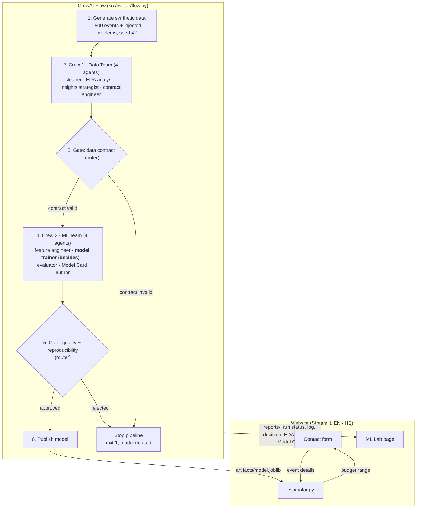

# RIVATAR – Event Budget Estimator

Final project (AI developer course) for **RIVATAR PRODUCTIONS**, a boutique and luxury event-production company in
Jerusalem (weddings, bar and bat mitzvahs, family events, conferences, product launches, corporate events).

The project has two parts that work together:

- **The website** (Streamlit, English and Hebrew): the company's portfolio, services and an envelope-style contact
  form. When a client sends the form, it shows a **first budget range** for their event: *a starting point, not a quote*.
- **The ML pipeline** behind that range: a **CrewAI Flow** with **two crews of four agents** and **two gates**. It
  cleans and analyses the data, signs a data contract, trains and compares three models, lets an agent **decide**
  which one to publish, and publishes it only if every gate passes. The **ML Lab** page on the site shows the last run.

Stack: Python 3.12 · CrewAI 1.15 · scikit-learn · pandas · Streamlit · pytest · GitHub Actions.

> **The data is synthetic** (generated from RIVATAR's business logic, seed 42). The results show that the method
> works end to end. They are **not** RIVATAR's real prices, and the model must be retrained on real events before
> its numbers mean anything for a client.

## Architecture



### The two crews

| Crew | Agents (in order) | Produces |
|---|---|---|
| **1 · Data Team** | Data Cleaning Specialist · EDA Analyst · Business Insights Strategist · Data Contract Engineer | `data/processed/events_clean.csv`, cleaning report, 4 EDA charts, `insights.md`, `artifacts/data_contract.json` |
| **2 · ML Team** | Feature Engineer · Model Trainer · Model Evaluator · Model Card Author | feature spec, model comparison, **model decision**, evaluation, `artifacts/model.joblib`, `model_card.md` |

The agents decide *when* to call their tools and *how* to explain the results. The numbers themselves come from tested,
deterministic Python code (`src/rivatar/tools/`), so a run is reproducible with or without an LLM.

### The two gates

1. **Data contract** (`src/rivatar/contract.py`). The clean dataset must match the contract the Data Team signed:
   the columns and types, allowed values, ranges, row count, sha256 of the file, and two cross-column rules (event
   after inquiry; client type matches event type). Every violation is collected, not just the first. If anything
   fails, the ML Team never runs.
2. **Quality and reproducibility.** The published model must be the one that was decided, have hold-out MAPE below
   25%, still match the signed contract, and give identical predictions when retrained from scratch with the same seed.

### Where an agent decides

Comparing the models does **not** pick a winner. The **Model Trainer agent** reads the cross-validation comparison and
a stated selection policy, and decides which version RIVATAR should publish:

> Only models with CV MAPE below 25% may be published. Among those, prefer the simpler model unless a more complex
> one lowers CV MAE by more than 5%: a simpler model is easier to explain to a producer and less likely to overfit.

It then calls `publish_selected_model` with a model name and a reason. The tool refuses unknown versions and versions
that break the MAPE limit (the agent must decide again). It records the decision with what the policy rule alone would
have chosen, in `reports/model_decision.json`. The Flow logs it as `[agent_decision]`, and ML Lab and the Model Card
show it. In offline mode the same policy rule makes the decision, so tests and CI need no API key.

A real decision from a live run is in [`docs/live-run-agent-decision.md`](docs/live-run-agent-decision.md).

## Results (synthetic data, seed 42)

1,530 raw rows (1,500 events + 30 duplicates) → **1,472 clean rows** after cleaning. The cleaning undoes exactly
what the generator injected (a test checks the counts). Train / test 1,177 / 295, 5-fold CV.

| Version | Complexity | CV MAE | CV MAPE | Hold-out MAE | Hold-out MAPE | Hold-out R² |
|---|---|---|---|---|---|---|
| **`v1_ridge_baseline`** (published) | 1 | ₪10,711 | 7.9% | **₪10,614** | **7.8%** | **0.928** |
| `v2_random_forest` | 2 | ₪16,726 | 12.6% | ₪17,865 | 12.9% | 0.806 |
| `v3_hist_gradient_boosting` | 3 | ₪13,006 | 9.7% | ₪12,873 | 9.0% | 0.901 |

- In the live run (`gpt-4o-mini`) the Model Trainer agent published **Ridge**, citing its CV MAPE of 7.94%, the lowest
  CV MAE and the lowest complexity. This matches the policy rule.
- 80% of hold-out predictions fall within about **−12% / +12%** of the true budget. The form shows this as the range.
- Retraining with the same seed gives identical predictions.
- **Read these numbers honestly.** The generator builds budgets from a mostly multiplicative formula. After the log
  transform, that is close to linear, so a linear model on log(budget) is *expected* to win. The result confirms that
  the pipeline recovers the logic it was given; it says nothing about how accurate the model would be on RIVATAR's real
  events. The smallest segments (business dinners, events abroad) have the widest errors.

## Setup (Windows / PowerShell)

Python **3.12** is required (CrewAI 1.15 does not support 3.13+).

```powershell
# one-time: create the venv outside the project folder
py -3.12 -m venv "$env:USERPROFILE\.venvs\ai-course-light"

# every session
& "$env:USERPROFILE\.venvs\ai-course-light\Scripts\Activate.ps1"
pip install -r requirements.txt
$env:PYTHONPATH = "src"

# only for runs with LLM agents: copy the template and add your OpenAI key (never commit .env)
Copy-Item .env.example .env
```

## How to run

```powershell
# the ML pipeline (CrewAI Flow)
python -m rivatar.main --offline                     # whole Flow, deterministic tools, no API key
python -m rivatar.main                               # with LLM agents (needs OPENAI_API_KEY in .env)
python -m rivatar.main --offline --inject-violation  # demo: corrupts the clean data -> contract gate stops (exit 1)

# the website
streamlit run app/streamlit_app.py                   # http://localhost:8501

# the tests (offline, about 2.5 minutes)
python -m pytest
```

- Exit codes: `0` model published · `1` stopped at a gate · `2` no API key and not `--offline`.
- **Site pages:** `/home`, `/about`, `/projects` and one page per project, `/services`, `/contact` (the form with the
  budget range), and `/ml-lab` (the last Flow run).
- **`--inject-violation`** corrupts 8 rows after the contract is signed. The gate reports 3 violations (sha256 mismatch,
  `birthday_party` is not an allowed event type, 5 guest counts below 10), the ML Team never runs, and no model is
  published. ML Lab then shows a red "Pipeline stopped" banner with every violation, and the form shows no estimate.
- **The tests** write to a temporary folder (`RIVATAR_OUTPUT_DIR`), so they never overwrite the run that ML Lab shows.
  CI (`.github/workflows/ci.yml`) runs the Flow offline, checks that `--inject-violation` exits with 1, then runs the tests.

## Repository rules

- **No data in git.** `data/`, `artifacts/` and `reports/` are git-ignored and regenerated by every run (seed 42).
  The original event photos (the `RIVATAR WEBSITE-*` Drive export) are never committed. Only curated web copies with
  EXIF/GPS stripped are committed (`app/static/projects/`, under a 40 MB budget).
- **No secrets in git.** `.env` is git-ignored; only `.env.example` (empty key) is committed. The OpenAI key is read
  from `.env` by `rivatar.config` and is never printed, logged or written to a report (a test checks this).
- **No real client data.** Form submissions go to `data/leads.csv` (git-ignored). Client names on the site are first
  names only, as approved.
- Pull requests are stacked: PR #1 (phase-1 site) → PR #2 (site redesign) → PR #3 (ML pipeline). Merge in that order.

## Content and media

- All site text is in `app/content/en.json` and `he.json`, and every project has its own file in
  `app/content/projects/` (photos, chapters, palette, EN/HE text and alt text). Contact details are in
  `app/content/site.json`. All of it can be edited without code.
- `python scripts/translate_content.py` drafts only missing or changed Hebrew, and never overwrites reviewed text.
- `python scripts/prepare_media.py` exports the curated photos named in the content files (400–1600 px, neutral
  names, no EXIF) and muted video loops, and checks the 40 MB budget.

## Project layout

```
app/                      Streamlit website
  streamlit_app.py        entry point and navigation
  content/                en.json, he.json, site.json, projects/*.json (all site text and media choices)
  theme.py, ui.py         styling and HTML building blocks
  views/                  home, about, projects, services, contact (form + estimate), ml_lab
  static/                 self-hosted fonts, curated project photos and video loops
src/rivatar/
  config.py               paths, seed, gates, model policy; .env via python-dotenv
  vocab.py                shared category codes (form = data = model)
  data_generator.py       synthetic dataset with injected quality problems
  contract.py             data-contract validation (gate 1)
  flow.py                 CrewAI Flow with the two routers
  main.py                 CLI: --offline, --inject-violation, --plot
  crews/                  data_crew.py, ml_crew.py (4 agents each), llm.py
  tools/                  data_ops.py, ml_ops.py (deterministic work) + CrewAI tool wrappers
  estimator.py            budget range for the website form
  leads.py                form validation and leads.csv
scripts/                  prepare_media.py, translate_content.py
tests/                    pytest: site, content, media, translator, ML pipeline
docs/                     live-run log with the agent's decision; design draft
```
